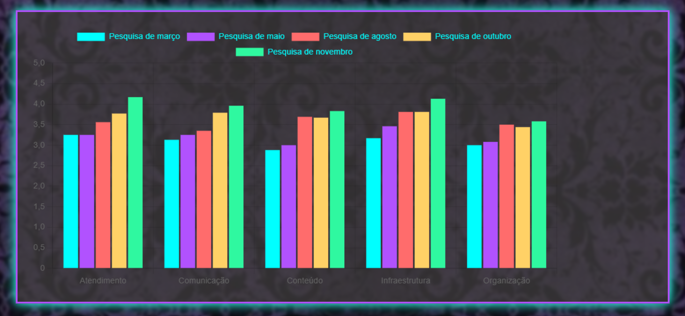
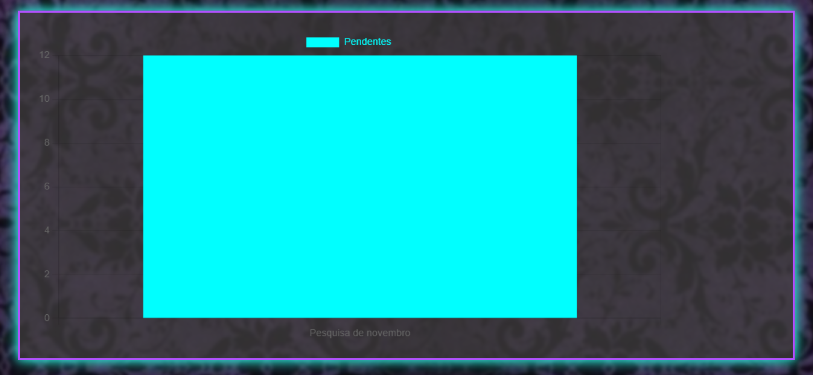
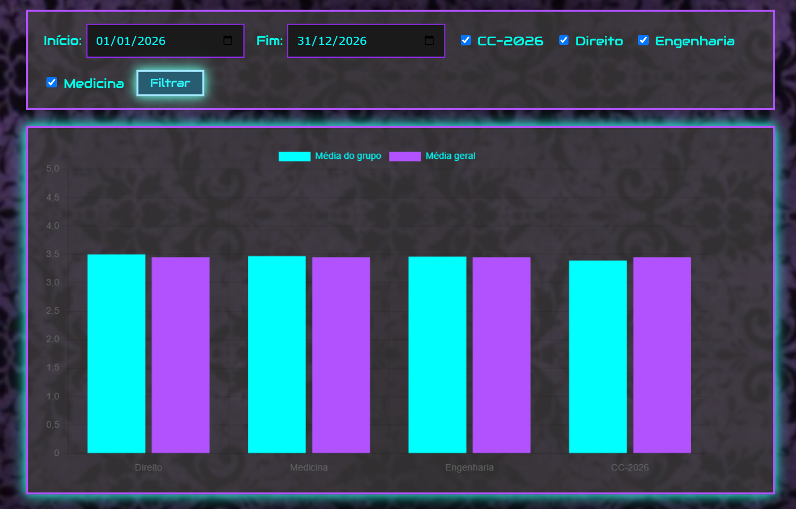
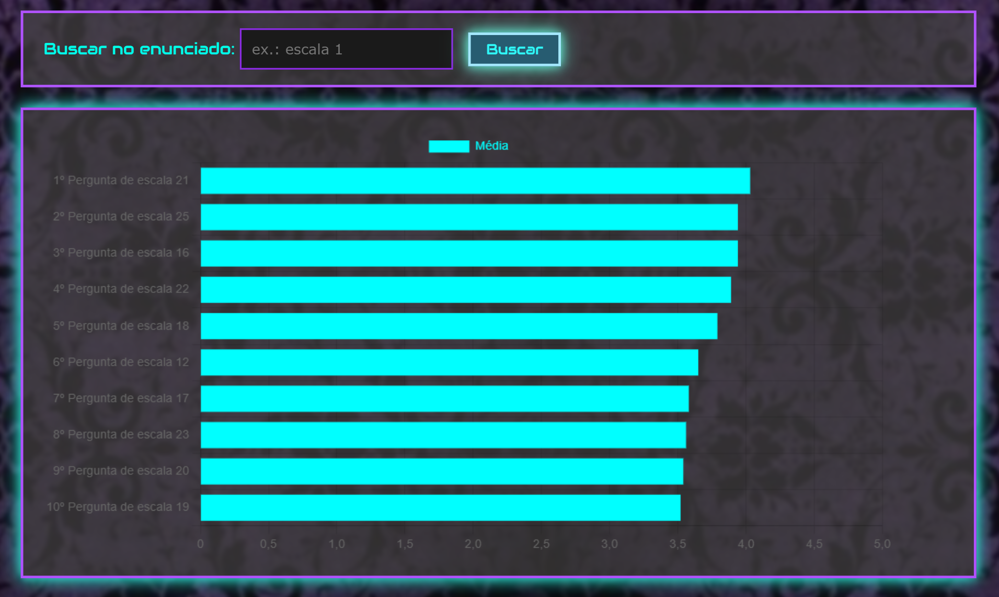

# Sistema de Avaliações: Pesquisa de Satisfação
Projeto da disciplina **Banco de Dados I (UEL)**, Prof. Dr. Anderson Paulo Avila Santos.

Sistema web de avaliações, com banco de dados PostgreSQL, em que é possível cadastrar questões, montar avaliações com essas questões, indicar quem deve responder cada avaliação, registrar as respostas e, no fim, ver relatórios com tabelas e gráficos sobre os resultados.

**Integrantes:** Ana Vitória Oliver Machado (Ciência da Computação)

## Sumário
- [Natureza escolhida](#natureza-escolhida)
- [Como rodar](#como-rodar)
- [Dados para teste](#dados-para-teste)
- [Funcionalidades](#funcionalidades)
- [Arquitetura](#arquitetura)
- [Descrição dos relatórios](#descrição-dos-relatórios)
--- 

## Natureza escolhida

**Pesquisa de satisfação ou de opinião.**

**Particularidade:** Questões em escala de 1 a 5 agrupadas por tema. Respostas podem ser de escolha ou texto livre. Os relatórios comparam temas (infraestrutura, atendimento, conteúdo etc.), períodos e grupos de  respondentes.

As respostas ficam identificadas (ligadas ao usuário), pois o enunciado define o anonimato como opcional para esta natureza.

### Tecnologias

| Parte | Tecnologia |
|---|---|
| Banco de dados | PostgreSQL |
| Back-end | Java com Spring Boot; acesso ao banco por JDBC (`JdbcTemplate`), com DAOs escritos à mão, sem JPA/Hibernate |
| Front-end | Thymeleaf (telas montadas no servidor) e Chart.js (gráficos) |
| Build | Maven (pelo `mvnw`, sem instalar nada) |

O Chart.js está no próprio repositório (`app/app/src/main/resources/static/js/chart.umd.js`), então os gráficos funcionam sem internet. A fonte do visual (Audiowide) vem do Google Fonts: sem internet o sistema funciona normalmente, só com uma fonte padrão.

### Estrutura do repositório

```
Bd1Projeto/
├── README.md
├── docs/                      DER.png, esquema-relacional.md (com a 3FN) e img/ (prints dos relatórios)
|
├── database/
│   ├── schema.sql             cria o banco do zero, com todas as restrições
│   ├── carga.sql              dados de teste
│   └── relatorios.sql         consultas dos relatórios
|
└── app/app/                   projeto Spring Boot
    ├── pom.xml
    └── src/main/
        ├── java/com/example/app/
        │   ├── controle/      controllers
        │   ├── modelo/        classes do modelo (POJOs)
        │   ├── dao/           DAOs com JdbcTemplate (todo o SQL fica aqui)
        │   └── config/        interceptors que exigem login e perfil de administrador
        |
        └── resources/
            ├── templates/     telas Thymeleaf
            └── static/        css, js (Chart.js) e imagens
```


### Modelo dos dados
esquema relacional:
| Tabela | Papel |
|---|---|
| `grupo` | turma ou curso dos usuários |
| `tema` | tema ao qual cada questão pertence |
| `usuario` | quem acessa o sistema: e-mail, senha com hash e perfil (administrador ou respondente) |
| `questao` | questão de tipo `ESCALA` ou `TEXTO`, ligada a um tema |
| `avaliacao` | a pesquisa, com título, descrição, data e horários |
| `avaliacao_questao` | quais questões compõem cada avaliação, e em que ordem |
| `avaliacao_usuario` | quais usuários devem responder cada avaliação |
| `resposta` | resposta de um usuário a uma questão de uma avaliação (`valor` de 1 a 5 ou `texto`) |


### Decisões do modelo:

- **`resposta` tem duas chaves estrangeiras compostas:** `(id_avaliacao, id_usuario)` aponta para `avaliacao_usuario` (só responde quem foi designado) e `(id_avaliacao, id_questao)` aponta para `avaliacao_questao` (só se responde uma questão que faz parte da avaliação).

- **`valor` ou `texto`:** um `CHECK` garante que cada resposta tem exatamente um dos dois, e outro `CHECK` limita `valor` ao intervalo de 1 a 5.

- **Perfil do usuário:** a coluna `usuario.administrador` (`BOOLEAN NOT NULL DEFAULT FALSE`) separa os administradores dos respondentes.

- **Senhas:** guardadas como hash (`crypt` da extensão `pgcrypto`), nunca em texto puro.

**3FN:** o esquema está na 3FN. Todas as tabelas têm chave primária e atributos atômicos (1FN); nas tabelas de chave composta (`avaliacao_questao`, `avaliacao_usuario`, `resposta`), todo atributo não-chave depende da chave inteira (2FN); e nenhum atributo não-chave depende de outro atributo não-chave (3FN). Por exemplo, o nome do tema só existe em `tema` e o nome do grupo só em `grupo`.

As restrições de integridade (`PRIMARY KEY`, `FOREIGN KEY`, `NOT NULL`, `UNIQUE`, `CHECK`) estão no `database/schema.sql`.

---
## Como rodar

**Requisitos**

- JDK 17 ou superior
- PostgreSQL 13 ou superior, com a extensão `pgcrypto`  (já vem com a instalação padrão)
- Maven não precisa ser instalado pois o projeto usa o `mvnw`

Rode os comandos a partir da raiz do repositório (`Bd1Projeto/`).


### 1. Criar o banco
No pgAdmin (ou no `psql`), crie um banco vazio chamado `avaliacoes`:

```sql
CREATE DATABASE avaliacoes;
```

### 2. Rodar os scripts, nesta ordem

Com o banco `avaliacoes` selecionado, execute primeiro `database/schema.sql` e depois `database/carga.sql`. Pelo `psql`:

```bash
psql -U postgres -d avaliacoes -f database/schema.sql
psql -U postgres -d avaliacoes -f database/carga.sql
```
obs: sempre que rodar o `schema.sql` de novo, rode o `carga.sql` em seguida (o `schema.sql` apaga e recria as tabelas).


### 3. Configurar a conexão

Em `app/src/main/resources/application.properties`, ajuste o usuário e a senha do PostgreSQL da sua máquina:

```properties
spring.datasource.url=jdbc:postgresql://localhost:5432/avaliacoes
spring.datasource.username=postgres
spring.datasource.password=SUA_SENHA
```

### 4. Subir a aplicação

Rode os comandos na pasta app (`Bd1Projeto/app/app`).

```bash
./mvnw spring-boot:run
```

ou `mvnw spring-boot:run`. A aplicação fica em <http://localhost:8080>.
Ao entrar se pede um login (nos dados abaixo) e será ou um administrador ou um respondente.  O administrador entra na tela de questões, e o respondente entra em *Minhas avaliações*.

## Dados para teste

**Login** (todos os 24 usuários da carga usam a senha `123456`)

| Perfil | E-mail | Senha |
|---|---|---|
| Administrador | `usuario1@exemplo.com` ou `usuario2@exemplo.com` | `123456` |
| Respondente |  qualquer um de `usuario3` a `usuario24` | `123456` |


**dados para teste**

  A carga cria 4 grupos, 5 temas, 24 usuários, 30 questões (25 de escala e 5 de texto livre), 5 avaliações e mais de mil respostas. As notas de escala são geradas com `random()` a partir de uma semente fixa (`setseed`), então a carga produz sempre os mesmos dados.

  Os usuários 1 a 12 responderam todas as avaliações. **Os usuários 13 a 24 ainda não responderam a *avaliação de novembro***: eles aparecem no relatório 2 e servem para testar a tela de resposta (por exemplo, entre com `usuario13@exemplo.com`).

---

## Funcionalidades

| Requisito | Tela | Quem acessa | O que faz |
|---|---|---|---|
| Login | `/login` | todos | E-mail e senha; o usuário fica na sessão e as demais telas exigem login |
| RF1 | `/questoes`, `/questoes/nova` | administrador | Lista e cadastra questões de escala (1 a 5) e de texto livre, cada uma com seu tema |
| RF2 | `/avaliacoes`, `/avaliacoes/nova` | administrador | Lista e cadastra avaliações (título, descrição, data, horário de início e de fim) |
| RF3 | `/avaliacoes/{id}/questoes` | administrador | Monta a avaliação escolhendo questões já cadastradas (a mesma questão pode estar em várias avaliações). Grava numa **transação**. Depois que a avaliação recebe respostas, a composição fica bloqueada |
| RF4 | `/avaliacoes/{id}/usuarios` | administrador | Indica quem deve responder, designando um grupo inteiro de uma vez |
| RF5 | `/minhas-avaliacoes`, `/responder/{id}` | quem foi designado | O usuário vê as avaliações designadas a ele e responde, uma única vez; todas as respostas são gravadas numa **transação** |
| RF6 | tela de resposta e relatórios | todos / administrador | Particularidade da natureza: as questões aparecem **agrupadas por tema** ao responder, e os relatórios comparam temas, períodos e grupos |
| RF7 | `/relatorios` | administrador | Quatro relatórios, cada um com tabela e gráfico (veja abaixo) |
| Usuários | `/usuarios` | administrador | Lista todos os usuários com grupo e perfil |

## Perfis de acesso

O sistema tem dois perfis, definidos pela coluna `usuario.administrador`.

| Rotas | Administrador | Respondente |
|---|---|---|
| `/login`, `/logout` | sim | sim |
| `/minhas-avaliacoes`, `/responder/{id}` | sim, se tiver sido designado | sim, se tiver sido designado (uma única vez) |
| `/questoes`, `/avaliacoes`, `/relatorios`, `/usuarios` | sim | não: volta para *Minhas avaliações* |

A restrição é feita no **servidor**, por um interceptor (`AdminInterceptor`), e não apenas escondendo botões do menu: um respondente que digitar `/relatorios` na barra de endereço é redirecionado. Além disso, só responde uma avaliação quem foi designado a ela e ainda não respondeu, e o usuário que responde vem sempre da sessão, nunca de um campo do formulário.

---
## Arquitetura

O código segue as camadas pedidas: a tela chama um **controller**, que usa o **modelo** e os **DAOs**, que falam com o banco.

- **Controllers** (`controle/`): recebem o pedido, validam e escolhem a tela. Não têm SQL.
- **Modelo** (`modelo/`): classes simples (POJOs) com atributos, getters e setters, e as validações (`@NotBlank`, `@Min`, `@Pattern`).
- **DAOs** (`dao/`): todo o SQL do sistema fica aqui, escrito à mão com `JdbcTemplate` (e `NamedParameterJdbcTemplate` nos filtros com `IN`). Os valores sempre entram como parâmetros, nunca concatenados no SQL.
- **Transações** (`@Transactional`): `AvaliacaoQuestaoDAO.salvarComposicao` (apaga a composição antiga e grava a nova) e `RespostaDAO.salvarTodas` (grava todas as respostas de um usuário). Se uma gravação falha, nenhuma delas fica no banco.
- **Login e perfis:** `LoginController` guarda o usuário na `HttpSession`; o `LoginInterceptor` redireciona para `/login` quem não está logado, e o `AdminInterceptor` (ambos em `config/`) bloqueia as rotas de administrador para os respondentes.
- **Telas** (`templates/`): Thymeleaf, com o menu do topo num fragmento reutilizado (que mostra só os botões permitidos ao perfil) e o visual num único `estilo.css`.


---
## Descrição dos relatórios

Cada relatório tem uma tabela e um gráfico, e todos são acessados pelo administrador. As consultas estão em [`database/relatorios.sql`](database/relatorios.sql) e são as mesmas usadas pelos DAOs. Nos relatórios 3 e 4, os valores dos filtros (período, grupos e palavra da busca) vêm dos campos da tela, e abaixo aparecem valores de exemplo.

### Relatório 1: média por tema em cada avaliação

- **Objetivo:** comparar a satisfação média de cada tema ao longo das avaliações.
- **Tela:** `/relatorios/media-tema`
- **Gráfico:** barras agrupadas (média por tema, uma cor por avaliação).
- **Recursos SQL:** JOIN, agregação (`AVG`, `COUNT`), `GROUP BY`, `ORDER BY`.



```sql
SELECT a.titulo, t.nome AS tema,
       ROUND(AVG(r.valor), 2) AS media,
       COUNT(r.valor)         AS respostas
FROM resposta r
JOIN avaliacao a ON a.id_avaliacao = r.id_avaliacao
JOIN questao q   ON q.id_questao   = r.id_questao
JOIN tema t      ON t.id_tema      = q.id_tema
GROUP BY a.id_avaliacao, a.titulo, a.data_aplicacao, t.id_tema, t.nome
ORDER BY a.data_aplicacao, t.nome;
```

### Relatório 2: quem ainda não respondeu cada avaliação

- **Objetivo:** listar os usuários designados a uma avaliação que ainda não responderam, e mostrar quantos faltam por avaliação.
- **Tela:** `/relatorios/pendentes`
- **Gráfico:** barras (pendentes por avaliação).
- **Recursos SQL:** `LEFT JOIN` (junção externa), JOIN, `GROUP BY`, `ORDER BY`.



Tabela (quem falta):

```sql
SELECT a.titulo AS avaliacao, u.nome AS usuario, g.nome AS grupo
FROM avaliacao_usuario au
JOIN avaliacao a ON a.id_avaliacao = au.id_avaliacao
JOIN usuario u   ON u.id_usuario   = au.id_usuario
JOIN grupo g     ON g.id_grupo     = u.id_grupo
LEFT JOIN resposta r ON r.id_avaliacao = au.id_avaliacao
                    AND r.id_usuario   = au.id_usuario
WHERE r.id_usuario IS NULL
ORDER BY a.titulo, u.nome;
```

Gráfico (pendentes por avaliação):

```sql
SELECT a.titulo AS avaliacao, COUNT(*) AS pendentes
FROM avaliacao_usuario au
JOIN avaliacao a ON a.id_avaliacao = au.id_avaliacao
LEFT JOIN resposta r ON r.id_avaliacao = au.id_avaliacao
                    AND r.id_usuario   = au.id_usuario
WHERE r.id_usuario IS NULL
GROUP BY a.id_avaliacao, a.titulo, a.data_aplicacao
ORDER BY a.data_aplicacao;
```

### Relatório 3: média de cada grupo comparada com a média geral

- **Objetivo:** ver quais grupos estão acima ou abaixo da média geral num período, escolhendo o período e os grupos.
- **Tela:** `/relatorios/grupos`, com filtro de datas (início e fim) e caixinhas para escolher os grupos.
- **Gráfico:** barras lado a lado (média do grupo e média geral).
- **Recursos SQL:** subconsulta, `HAVING`, filtro com datas (`BETWEEN`) e com `IN`, JOIN, `GROUP BY`.




```sql
SELECT g.nome AS grupo,
       ROUND(AVG(r.valor), 2) AS media_do_grupo,
       (SELECT ROUND(AVG(valor), 2) FROM resposta) AS media_geral
FROM resposta r
JOIN usuario u   ON u.id_usuario   = r.id_usuario
JOIN grupo g     ON g.id_grupo     = u.id_grupo
JOIN avaliacao a ON a.id_avaliacao = r.id_avaliacao
WHERE a.data_aplicacao BETWEEN '2026-01-01' AND '2026-12-31'
  AND g.nome IN ('CC-2026', 'Engenharia', 'Medicina', 'Direito')
GROUP BY g.nome
HAVING COUNT(r.valor) >= 10
ORDER BY media_do_grupo DESC;
```

### Relatório 4: ranking das 10 questões de escala mais bem avaliadas

- **Objetivo:** identificar os itens com melhor avaliação média.
- **Tela:** `/relatorios/ranking`, com um campo de busca no enunciado da questão.
- **Gráfico:** barras horizontais (média por questão).
- **Recursos SQL:** `RANK()`, `FETCH FIRST`, JOIN, `GROUP BY`, filtro com `LIKE`.



```sql
SELECT RANK() OVER (ORDER BY AVG(r.valor) DESC) AS posicao,
       q.enunciado,
       ROUND(AVG(r.valor), 2) AS media
FROM questao q
JOIN resposta r ON r.id_questao = q.id_questao
WHERE q.tipo = 'ESCALA'
  AND LOWER(q.enunciado) LIKE LOWER('%pergunta%')
GROUP BY q.id_questao, q.enunciado
ORDER BY posicao
FETCH FIRST 10 ROWS ONLY;
```

### Recursos SQL cobertos

| Recurso | Relatório |
|---|---|
| Junção interna (`JOIN`) | todos |
| Junção externa (`LEFT JOIN`) | 2 |
| Agregação e agrupamento (`COUNT`, `AVG`, `GROUP BY`, `HAVING`) | 1, 3 e 4 (o `HAVING` está no 3) |
| Subconsulta | 3 |
| Ordenação e ranking (`ORDER BY`, `RANK()`, `FETCH FIRST`) | 4 |
| Filtros (`WHERE` com datas, `IN`, `LIKE`) | 3 (datas e `IN`) e 4 (`LIKE`) |
